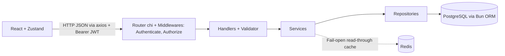
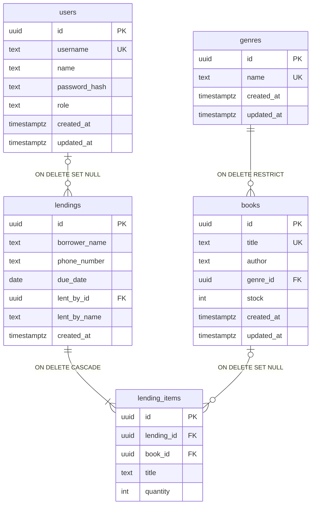
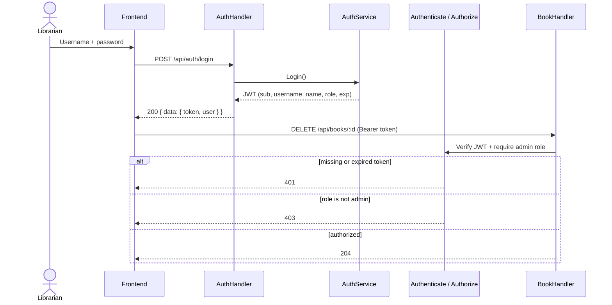
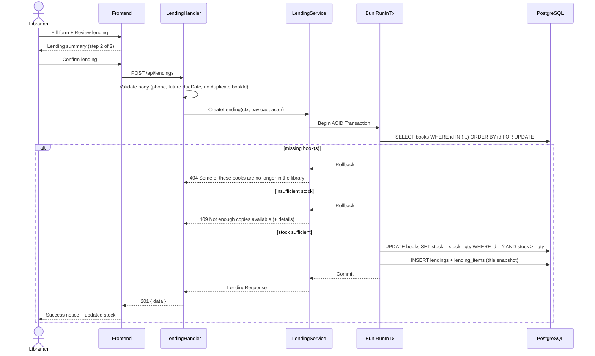

# API Contract — Vartama Library

## Conventions

- Base URL: `/api`
- Success envelope: `{ "data": ... }`
- Error envelope: `{ "message": "...", "details"?: [{ "field": "...", "message": "..." }] }`
- Auth: `Authorization: Bearer <jwt>`
- All primary keys use UUID strings.

## Architecture

- **Router & Middlewares** — URL routing, rate limiting, JWT verification (`Authenticate`), and role check (`Authorize`).
- **Handlers** — Decode and validate JSON/query inputs, call services, and format standard JSON envelopes.
- **Services** — Business logic (ACID lending transactions, genre deletion guard, authentication, cache orchestration).
- **Repositories** — The only layer interacting directly with Bun ORM and PostgreSQL.
- **Models** — Bun table mappings (`users`, `genres`, `books`, `lendings`, `lending_items`) and response DTOs.

## Data Model

## Sequence Diagrams

### Login & Protected Request

### Create Lending (Atomic SQL Transaction)

## Endpoints

| Method | Path | Feature | Auth | Notes |
|---|---|---|---|---|
| `GET` | `/api/health` | — | Public | Returns `{ status: "ok", cache: "up" \| "down" \| "off" }` |
| `POST` | `/api/auth/login` | Auth | Public (10 req / 15m per IP) | Returns `{ token, user }` |
| `GET` | `/api/auth/me` | Auth | Login | Returns `{ id, username, name, role }` |
| `GET` | `/api/books` | F3, F4, F5, Search/Page | Login | Query: `search`, `genreId`, `sortBy=title\|stock`, `order=asc\|desc`, `page`, `limit` |
| `GET` | `/api/books/overview` | Sidebar copies counter | Login | Returns `{ totalBooks, totalCopies }` |
| `POST` | `/api/books` | F1 | **Admin** | `{ title, author, genreId, stock >= 1 }` → `201` |
| `PATCH` | `/api/books/:id` | Edit book | **Admin** | Partial `{ title?, author?, genreId?, stock? >= 0 }` → `200` |
| `DELETE` | `/api/books/:id` | F2 | **Admin** | `204`; lending history snapshots are preserved |
| `GET` | `/api/genres` | Genre master | Login | Returns `[{ id, name, bookCount }]` |
| `POST` | `/api/genres` | Genre master | **Admin** | `{ name }` → `201` |
| `PATCH` | `/api/genres/:id` | Genre master | **Admin** | `{ name }` → `200` |
| `DELETE` | `/api/genres/:id` | Genre master | **Admin** | `204`; returns `409` if `bookCount > 0` |
| `POST` | `/api/lendings` | F6, F7 | Login | Atomic lending creation (`201`) |
| `GET` | `/api/lendings` | F9 | Login | Newest first (`createdAt` desc) |

## Error Status Codes

- `400` — Invalid JSON, invalid UUID, or validation failure (`details` includes field-level messages)
- `401` — Missing/expired JWT or wrong login credentials
- `403` — Insufficient role permission (`admin` required)
- `404` — Route or target resource not found
- `409` — Duplicate title/genre name, genre still in use, or insufficient stock during lending
- `429` — Login rate limit exceeded
- `500` — Unexpected server error
