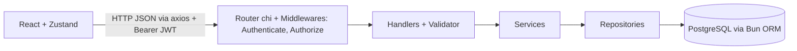
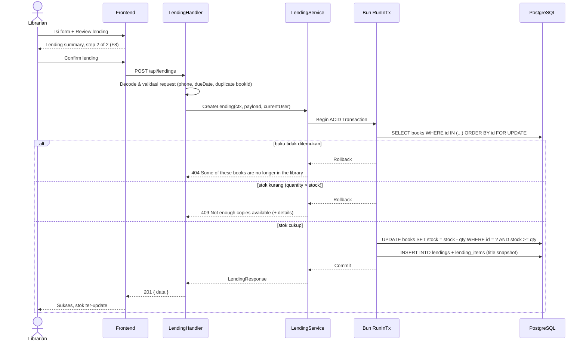
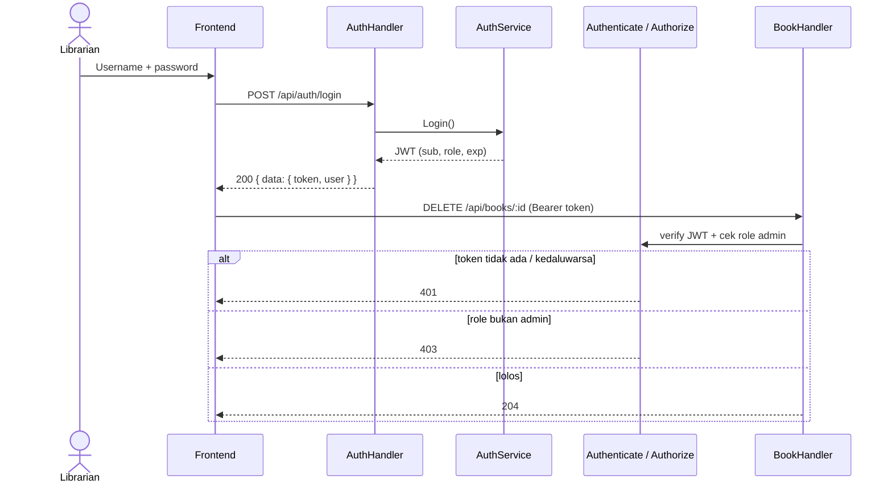

# 08 — `docs/contract-and-readme`

## Tujuan
Dokumentasi kontrak sistem (API ↔ service) dalam Mermaid dan README langkah demi langkah.

> **Implementasi:** `docs/api-contract.md` (konvensi, arsitektur flowchart, ER diagram, matriks akses, semua endpoint dengan contoh request/response/error, 2 sequence diagram, tabel error) dan `README.md` (fitur F1–F9 + tambahan, quick start Docker, jalan lokal, akun demo, test, konfigurasi ENV, struktur, catatan desain, troubleshooting). Pastikan semua diagram Mermaid tervalidasi parser mermaid@11.

## `docs/api-contract.md`

### 1. Arsitektur (flowchart)

Jelaskan tanggung jawab tiap layer dalam satu kalimat:
- **Router & Middlewares** — mapping URL, rate limiting, verifikasi JWT (`Authenticate`), dan cek role (`Authorize`)
- **Handlers** — decode & validasi JSON/query (`validator/v10`), panggil service, bentuk response JSON standar
- **Services** — aturan bisnis (cek stok dalam transaksi SQL `RunInTx`, proteksi hapus genre, otentikasi)
- **Repositories** — satu-satunya layer yang menyentuh Bun ORM / query PostgreSQL
- **Models** — definisi struct Bun (`users`, `genres`, `books`, `lendings`, `lending_items`) dan relasinya

### 2. Data model (`erDiagram`)
Relasi tabel PostgreSQL:
- `users` (`id`, `username`, `name`, `password_hash`, `role`)
- `genres` (`id`, `name`) — `1:N` ke `books` (`genre_id` `ON DELETE RESTRICT`)
- `books` (`id`, `title`, `author`, `genre_id`, `stock`)
- `lendings` (`id`, `borrower_name`, `phone_number`, `due_date`, `lent_by_id`, `lent_by_name`, `created_at`) — `lent_by_id` `ON DELETE SET NULL` ke `users`
- `lending_items` (`id`, `lending_id`, `book_id`, `title`, `quantity`) — `lending_id` `ON DELETE CASCADE`, `book_id` `ON DELETE SET NULL` ke `books`

### 3. Sequence diagram — Create Lending


### 3b. Sequence diagram — Login & request terproteksi


### 4. Tabel endpoint
Untuk setiap endpoint: method, path, query/body, contoh response sukses, kode error yang mungkin.

| Method | Path | Fitur | Auth |
|---|---|---|---|
| GET | `/api/health` | — | publik |
| POST | `/api/auth/login` | Login | publik (rate limited) |
| GET | `/api/auth/me` | Profil | login |
| GET | `/api/books?genreId=&sortBy=&order=` | F3, F4, F5 (+ search/pagination di branch 10) | login |
| GET | `/api/books/overview` | Total books & total copies (sidebar) | login |
| POST | `/api/books` | F1 | **admin** |
| PATCH | `/api/books/:id` | Edit buku | **admin** |
| DELETE | `/api/books/:id` | F2 | **admin** |
| GET | `/api/genres` | Master genre (+ bookCount) | login |
| POST / PATCH / DELETE | `/api/genres[/:id]` | Kelola genre (hapus ditolak jika dipakai) | **admin** |
| POST | `/api/lendings` | F6, F7 | login |
| GET | `/api/lendings` | F9 | login |

Plus format error standar `{ message, details? }` dan daftar status code (400, 401, 403, 404, 409, 429, 500).

> Pastikan diagram Mermaid ter-render di GitLab (GitLab mendukung blok ```` ```mermaid ```` di Markdown). Opsional: export juga ke `docs/architecture.png`.

## `README.md` (update)

Struktur:
1. Deskripsi singkat & daftar fitur (F1–F9)
2. Tech stack (Frontend React + Tailwind + Zustand; Backend Go + chi + Bun ORM + PostgreSQL)
3. Struktur proyek (tree singkat BE & FE)
4. **Prasyarat**: Go 1.24+, Node 24 / npm (untuk frontend), Docker (untuk PostgreSQL / Redis / full stack)
5. **Run lokal** (step by step):
   ```bash
   docker compose up -d postgres
   cd backend && cp .env.example .env && go run ./cmd/seed && go run ./cmd/api
   cd frontend && cp .env.example .env && npm install && npm run dev
   ```
   Buka `http://localhost:5173`
6. **Run via Docker**:
   ```bash
   docker compose up -d --build
   docker compose run --rm backend /bin/seed
   ```
   Buka `http://localhost:8080`
7. **Environment variables** — tabel BE (`DATABASE_URL`, `JWT_SECRET`, `JWT_EXPIRES_IN`, `SEED_*_PASSWORD`, `REDIS_URL`) & FE (`VITE_API_URL`)
7b. **Akun demo & hak akses** — tabel `admin` / `admin123` (Head Librarian, role admin) dan `staff` / `user123` (role user) + matriks akses singkat
8. **Testing** — `go test ./...` di `backend/`, `npm test` di `frontend/`
9. **API docs** — link ke `docs/api-contract.md`
10. Screenshot (opsional, `docs/screenshots/`)
11. Catatan desain:
    - UI mengikuti design system (token Tailwind, tema light/dark via `data-theme`)
    - Konsistensi stok peminjaman memakai transaksi ACID PostgreSQL (`RunInTx` + `SELECT ... FOR UPDATE` + urutan lock deterministik)
    - UUID dipakai sebagai primary key agar kompatibel dengan kontrol form & kontrak string di frontend
    - `axios` & `tailwind` di-pin versi exact
    - Auth: JWT Bearer di `localStorage` (sederhana; untuk produksi bisa cookie `httpOnly`), tanpa registrasi publik

## Selesai jika
- [ ] Diagram ter-render di GitLab
- [ ] Ikuti README dari clone bersih → aplikasi jalan (lokal & Docker)

## Saran commit
`docs: add api contract diagrams and setup instructions`
